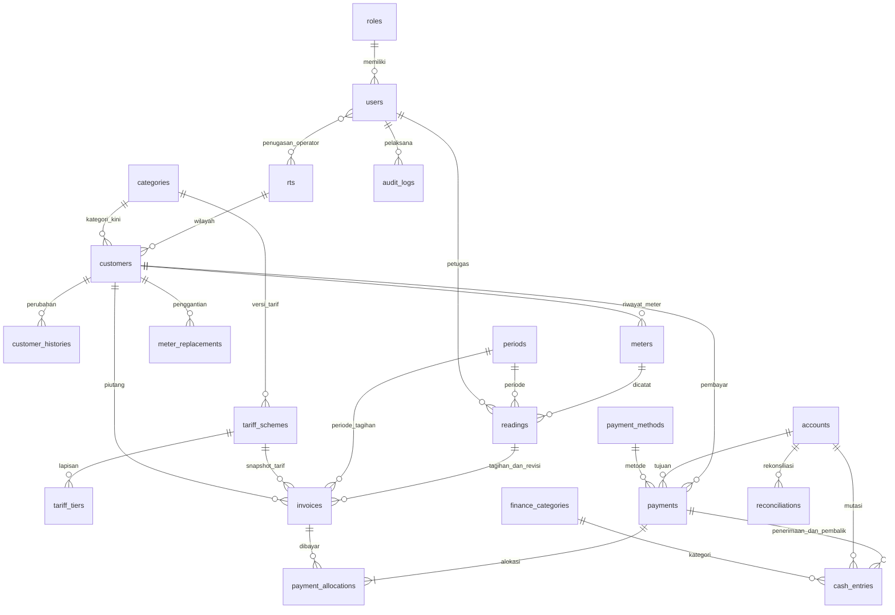

# Analisis, asumsi, dan rancangan

## Ruang lingkup dan keputusan bisnis

PAM RW.10 melayani wilayah RT yang dikelola dinamis. Data awal mencakup RT.01–RT.09; tidak ada batas sembilan RT di query operasional. Pelanggan memiliki nomor permanen, identitas meter terpisah, kategori pelanggan, dan status aktif/nonaktif/diputus sementara.

Satu periode adalah satu bulan kalender dan memiliki tanggal jatuh tempo tersendiri. Jika pencatatan bulan sebelumnya terlewat, operator harus menyelesaikan bulan terlewat; sistem tidak membebankan seluruh selisih ke bulan berikutnya. Proses ini mengutamakan akurasi; penggunaan historis tidak diestimasi otomatis.

Uang disimpan sebagai BIGINT rupiah, bukan floating point. Meter dan pemakaian memakai DECIMAL(14,3) serta string BCMath untuk operasi. Pembulatan ke rupiah dilakukan sesudah perhitungan, mengikuti mode dan kelipatan pada skema tarif; awalnya half-up ke Rp1. Periode dan tarif lama dipertahankan melalui snapshot. Tampilan angka meter menggunakan pemisah desimal Indonesia, sedangkan formulir/template menerima titik sebagai pemisah desimal.

Konfigurasi awal Rumah adalah abonemen termasuk kuota 20 m³ Rp45.000, lalu lapisan 20–40 m³ Rp3.000/m³ dan di atas 40 m³ Rp3.500/m³. Fasilitas Umum menggunakan Rp1.500/m³ dengan biaya tetap nol. Denda dan biaya tambahan awalnya nol. Metode included, additive, dan minimum dibedakan dalam `TariffService`; lapisan progresif tidak mengalikan seluruh pemakaian dengan harga tertinggi.

Kebijakan awal pelanggan nonaktif adalah tidak ditagih. Pelanggan yang mulai di tengah bulan mengikuti kebijakan full yang dapat diubah; bila prorata diaktifkan, hanya komponen biaya tetap yang diprorata menurut hari layanan. Kuota tetap utuh dan pemakaian mengikuti angka meter aktual. Ini merupakan asumsi yang perlu disetujui pengurus sebelum mengaktifkan prorata.

Penerimaan hanya diakui saat transaksi kas tercatat. Penerbitan tagihan menciptakan piutang, bukan saldo kas. Tunggakan adalah sisa tagihan terdahulu dan tidak disalin menjadi piutang/pendapatan baru. Pembayaran sebagian dan lintas periode menggunakan alokasi ke invoice. Kelebihan pembayaran ditolak; saldo titipan tidak diaktifkan.

Koreksi tagihan dilakukan dengan pembatalan beralasan, koreksi pencatatan jika perlu, dan tagihan pengganti dengan revisi serta hubungan `replacement_for`. Pembayaran sah harus dibalik dahulu sebelum invoice dibatalkan. Satu invoice aktif per pelanggan/periode dijaga oleh constraint `active_slot`; invoice batal memakai NULL dan tetap disimpan.

Pembatalan pembayaran membuat entri kas pembalik, mempertahankan entri asli serta alokasi historis, lalu mengurangi `invoice.paid_amount`. Pembalik dicatat di tanggal periode terbuka menurut prosedur service, bukan menghapus mutasi lama. Laporan penerimaan memakai tanggal entri kas dan nominal bertanda agar bulan penerimaan lama tidak berubah ketika pengembalian terjadi bulan berikutnya.

Pengeluaran/pemasukan umum dan transfer akun tidak memiliki alokasi RT. Filter RT/kategori/periode tagihan pada buku kas hanya menyertakan alokasi pembayaran air yang sesuai; biaya umum tidak dialokasikan secara rekaan. Saldo untuk potongan wilayah adalah arus kas potongan tersebut, bukan saldo rekening bank penuh. Untuk saldo akun penuh, kosongkan filter wilayah/kategori/periode/metode.

Saldo awal akun berlaku sejak awal keseluruhan riwayat. Setelah ada periode ditutup, aplikasi menolak perubahan saldo awal serta akun baru dengan saldo awal bukan nol, agar laporan historis tetap sama. Akun baru sesudah tutup buku dimulai dari nol, lalu diisi melalui transfer atau penerimaan yang sah pada periode terbuka. Identitas akun tetap dapat diperbarui dengan alasan.

## Struktur lapisan

Controller menangani validasi input, otorisasi, dan respons. Model Eloquent menangani relasi serta cast. `TariffService`, `MeterService`, `BillingService`, `PaymentService`, `FinanceService`, `ReportService`, `ExportService`, `NumberService`, `SettingService`, dan `AuditService` memusatkan aturan domain.

Operasi keuangan dan nomor dokumen dijalankan dalam database transaction dengan row lock. Constraint database menjadi pengaman terakhir terhadap duplikasi dan referensi yang tidak sah. Idempotency key pembayaran disertai sidik permintaan; pengiriman ulang permintaan yang sama mengembalikan pembayaran yang sama, sedangkan penggunaan ulang kunci untuk isi berbeda ditolak.

`User::requirePermission()` memeriksa permission server. `scopeCustomers()` dan `canAccessCustomer()` membatasi operator pada RT penugasannya, termasuk laporan, ekspor, barcode, unggahan privat, dan transaksi langsung. Role serta daftar permission dapat diubah melalui Admin; aplikasi menjaga agar tetap ada administrator aktif yang memiliki akses pengelolaan pengguna/role.

File privat tidak disajikan langsung oleh web server. Blade melakukan escaping data teks. XLSX menulis input teks secara eksplisit sebagai `TYPE_STRING`, sehingga awalan formula dan nol awal tidak menjadi formula. Identitas pada Code 128 hanya nomor pelanggan; pengguna tetap harus login dan lolos pemeriksaan wilayah.

## Relasi data

| Tabel | Tujuan dan integritas utama |
|---|---|
| roles, users, operator_rt | Role, permission JSON, status akun, relasi penugasan RT unik. |
| rts, categories | Master dinamis; nonaktif menggantikan penghapusan data yang telah dipakai. |
| settings | Parameter bisnis bertipe JSON; formulir terstruktur, tanpa editor SQL/kode. |
| sequences | Counter dokumen yang dikunci saat nomor baru dibuat. |
| customers | Nomor unik permanen, RT/kategori kini, alamat dan status layanan. |
| customer_histories | Sebelum/sesudah perubahan, alasan, pelaksana. |
| meters, meter_replacements | Serial unik, tanggal pasang/pensiun, angka akhir/awal, relasi meter lama/baru. |
| periods | Nama bulan unik, tanggal layanan/jatuh tempo, penguncian dan pelaksana. |
| tariff_schemes, tariff_tiers | Versi efektif per kategori, biaya/kuota/pembulatan, lapisan tersusun. |
| readings | Unik pelanggan/periode, angka meter desimal, status, foto privat, snapshot pelanggan. |
| invoices | Nomor/revisi, snapshot tarif/pelanggan, rincian hitung, total/paid_amount/status, satu slot aktif per pelanggan/periode. |
| payments, payment_allocations | Kuitansi unik, kunci idempoten unik, alokasi unik pembayaran/tagihan, riwayat pembatalan. |
| accounts, payment_methods | Akun kas/bank, saldo awal, metode pembayaran aktif. |
| finance_categories, cash_entries | Kategori pemasukan/pengeluaran; arus masuk/keluar positif, status, pembalik, kunci transfer. |
| reconciliations | Saldo buku, saldo rekening, selisih, tanggal, petugas dan catatan. |
| audit_logs | Aktivitas, objek, pelaksana, waktu, IP, alasan serta sebelum/sesudah. |
| sessions, jobs, failed_jobs, cache | Infrastruktur Laravel untuk sesi, pekerjaan latar belakang, dan cache status ekspor. |

## Arti laporan dan filter

`ReportService::TYPES` mencakup 15 kelompok laporan. Seluruh angka dihitung dari data tersimpan. Layar menampilkan 50 baris per halaman; subtotal dan ekspor memakai seluruh hasil yang sudah diotorisasi.

| Filter | Arti |
|---|---|
| Periode tagihan | Bulan invoice/pencatatan yang dilaporkan. Pada penerimaan, memilih bagian alokasi yang menuju bulan itu. |
| Tanggal dari/sampai | Tanggal pencatatan untuk meter, tanggal kas untuk penerimaan/kas, dan tanggal audit untuk aktivitas. Pada laporan rekening, memilih pembayaran sah bertanggal tersebut. |
| RT/kategori | Identitas kini untuk master pelanggan, snapshot historis untuk meter/invoice/penerimaan. |
| Status pembayaran | Status invoice saat laporan diminta. Laporan tagihan mengecualikan draft dan batal dari total piutang. |
| Operator | Petugas pencatatan yang mendasari invoice; untuk audit berarti pelaksana aktivitas. |
| Metode/akun | Memilih transaksi/alokasi pembayaran terkait. |
| Rekap bulanan/tahunan | Invoice dikelompokkan menurut bulan tagihan; penerimaan/pengeluaran menurut bulan kas. |

Kolom “Pembayaran terpilih” mengikuti filter tanggal/metode/akun. Kolom “Sisa kini” mengikuti seluruh pembayaran sah, sehingga keduanya sengaja tidak selalu memenuhi `tagihan − pembayaran terpilih = sisa kini`. Pengembalian tampil negatif pada laporan penerimaan kas; alokasi pembayaran yang sudah dibalik tidak dihitung sebagai pembayaran sah pada laporan piutang kini.

Umur piutang dihitung sejak tanggal jatuh tempo sampai hari laporan, dengan kelompok 1–30, 31–60, 61–90, dan lebih dari 90 hari. Tagihan batal dan draft tidak menambah umur/piutang. Snapshot pelanggan mencegah perubahan nama/RT/kategori mengubah laporan historis invoice dan pemakaian.

Ekspor berisi identitas PAM, judul, filter, tanggal cetak WIB, subtotal RT bila ada, dan total keseluruhan. PDF memakai header tabel berulang dan nomor halaman. XLSX mempertahankan angka sebagai numerik. Ekspor besar memakai antrean; pemohon harus tetap memiliki izin dan wilayah yang sama saat mengunduh berkas privat.

## Penghapusan pelanggan dan integritas riwayat

Customer menggunakan SoftDeletes/deleted_at. Keunikan customers.number tetap meliputi seluruh baris, termasuk yang sudah dihapus; penomoran tidak direset. CustomerPolicy mengotorisasi create dengan pelanggan.create dan delete dengan pelanggan.delete serta wilayah operator. Konfigurasi izin lama dimigrasikan tanpa memberi izin hapus kepada seluruh role.

CustomerService::delete mengambil lock periode, pelanggan, dan tagihan dalam transaksi. Saldo positif dari tagihan issued/partial menghalangi penghapusan; draft dan cancelled bukan piutang terbit. Sesudah lolos pemeriksaan, status menjadi inactive dan deleted_at diisi. CustomerHistory dan AuditLog ditulis dalam transaksi yang sama. Relasi serta query laporan historis memakai withTrashed dengan pembatasan RT tetap aktif, sedangkan daftar pelanggan dan pemilihan pelanggan operasional memakai scope standar. Pembatalan/kuitansi/pelunasan piutang yang terbuka kembali tetap bekerja, tetapi penerbitan tagihan baru untuk pelanggan terhapus diblokir.
